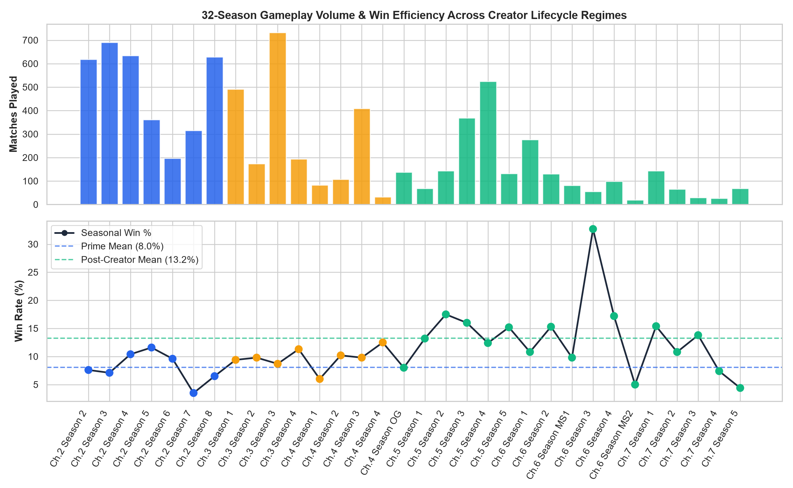
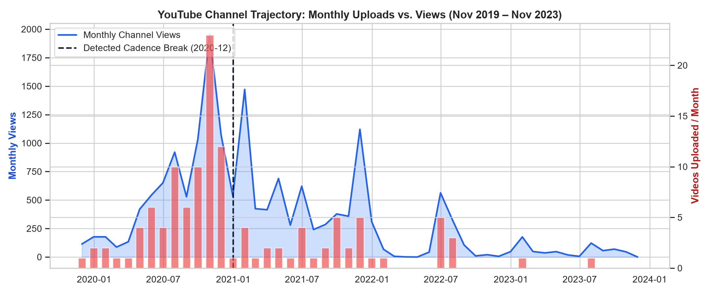
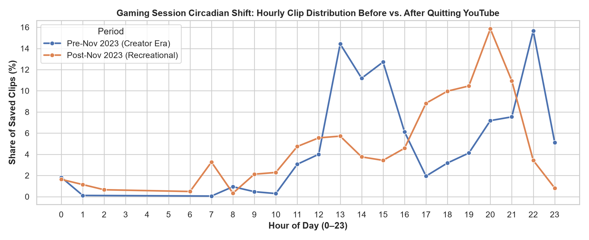

# Why Do Gaming Creators Quit? A Longitudinal Analysis of Gameplay Performance, Highlight Generation, and Audience Feedback (2018–2026)

**Course:** DSA210 — Introduction to Data Science (Fall 2026)  
**Author:** Abdul Rahman Muhammad Ehsan Ul Haque  

---

## Executive Summary
Many independent gaming creators start uploading consistently, reach a creative peak, and eventually abandon their channels—even while continuing to play the game for years afterward.

By merging **three personal longitudinal datasets** spanning **8 years of gameplay clips (`2,769` clips)**, **32 seasons of Fortnite Tracker telemetry (`8,039` matches, `1,117` hours)**, and **4 years of YouTube Studio analytics (`130` videos, `16,761` views)**, this study tests whether quitting YouTube in November 2023 was driven by declining in-game skill, algorithmic stagnation, or the "creator burden" of content production.

### Key Empirical Findings
* **The "Creator Burden" Effect ($p = 0.0222$):** Seasonal win rate jumped from **8.04%** during the **Prime Creator Era (`Ch.2 S2–S8`)** to **13.23%** during the **Post-Creator Era (`Ch.4 OG–Ch.7 S5`)** (Mann-Whitney $U = 23.0, p = 0.0222$), independent of seasonal match volume ($r = -0.174, p = 0.3413$).
* **Upload Cadence Broke Before Views Collapsed ($p = 0.0001$):** Change-point detection on monthly YouTube activity isolates **`2020-12`** ($p = 0.0001$) as the exact structural break in upload cadence. Lagged uploads at month $t-1$ strongly drive views at month $t$ ($r = 0.739, p < 0.0001$), confirming that creator upload fatigue preceded audience decay.
* **Format Performance Trade-Off:** **Edited Highlights** (`n = 24`) achieved the highest median views (`140.0`) and click-through rate (`9.36%` median CTR), whereas **Casual / Unedited Uploads** (`n = 95`) made up 73% of uploads but yielded `41%` fewer median views (`83.0`).
* **Circadian Session Consolidation:** After quitting YouTube in November 2023, afternoon (`13:00–15:00`) and late-night (`22:00`) clip-hunting spikes disappeared, consolidating into a single prime-evening recreational window (`17:00–21:00`).

---

## 1. Hypothesis 1: The "Creator Burden" Across Lifecycle Regimes

To evaluate whether content creation impacted in-game performance, all 32 tracked seasons (`Ch.2 Season 2` through `Ch.7 Season 5`) were segmented into three behavioral regimes:

| Lifecycle Regime | Season Span | Seasons | Total Matches | Avg Matches / Season | Hours Played | Mean Win % | Mean Top-Tier Placement % |
| :--- | :--- | :---: | :---: | :---: | :---: | :---: | :---: |
| **1. Prime Creator Era** | Ch.2 S2 – Ch.2 S8 *(Feb 2020 – Dec 2021)* | 7 | **3,446** | **492.3** | **490.6h** | **8.04%** | 22.11% |
| **2. Channel Decay Era** | Ch.3 S1 – Ch.4 S4 *(Dec 2021 – Nov 2023)* | 8 | 2,223 | 277.9 | 335.9h | 9.71% | 24.94% |
| **3. Post-Creator Control** | Ch.4 OG – Ch.7 S5 *(Nov 2023 – Nov 2026)* | 17 | 2,370 | 139.4 | 290.6h | **13.23%** | **31.22%** |

* **Kruskal-Wallis Test across all 3 Regimes (Win %):** $H = 6.803, p = 0.0333$
* **Mann-Whitney U Test (Prime Creator vs. Post-Creator Win %):** $U = 23.0, p = 0.0222$
* **Spearman Correlation (Matches Played vs. Win %):** $r = -0.174, p = 0.3413$ *(rules out match volume as a confounder)*



---

## 2. Hypothesis 2: Algorithmic Burnout vs. Upload Cadence Break

Analyzing daily and monthly YouTube Studio time-series data (`Nov 1, 2019 – Nov 1, 2023`) tests the causal direction between upload frequency and channel views:

* **Same-Month Uploads vs. Views (Spearman):** $r = 0.916, p < 0.0001$
* **Lagged Uploads ($t-1$) vs. Views ($t$) (Spearman):** $r = 0.739, p < 0.0001$
* **Structural Break Detection (SSE Change-Point + Mann-Whitney U):** **`2020-12`** ($p = 0.0001$)



---

## 3. Hypothesis 3: Content Format Efficiency & Gaming Session Shifts

### Video Format Breakdown (`Table data.csv`, $N = 124$ dated uploads)
| Video Format | Count | Median Views | Mean Views | Median Watch Time (hrs) | Median CTR (%) |
| :--- | :---: | :---: | :---: | :---: | :---: |
| **Edited Highlights / Synced Montages** | 24 | **140.0** | 176.58 | 2.69 | **9.36%** |
| **Long-Form / League Streams** | 5 | 106.0 | **251.60** | **11.18** | 6.02% |
| **Casual / Unedited Uploads** | 95 | 83.0 | 107.48 | 2.99 | 8.68% |

### Circadian Gaming Session Shift (`clips_metadata.csv`, $N = 2,310$ playable clips)
Comparing hourly clip timestamps before and after November 2, 2023 reveals how daily play routines shifted from dual-block content grinding (`13:00–15:00` and `22:00`) to relaxed prime-evening sessions (`17:00–21:00`).



---

## Data Sources & Methodological Controls

| Dataset | Time Span | Repository Path | Records |
| :--- | :--- | :--- | :--- |
| **YouTube Channel Analytics** | Nov 1, 2019 – Nov 1, 2023 | `data/raw/youtube/` | `130` videos, `1,462` daily channel rows |
| **Local Gameplay Clips** | Sep 2018 – Nov 2026 | `data/processed/clips_metadata.csv` | `2,769` deduplicated clips (`2,310` playable) |
| **Fortnite Tracker Seasons** | Feb 2020 – Nov 2026 | `data/processed/fortnite_seasons_clean.csv` | `32` seasons, `8,039` matches |

**Control for Archival/Recency Bias:**  
Systematic local clip-saving habits began in 2023 (`2,295` clips recorded in 2023 vs. `172` across 2020–2022). To prevent logging bias from distorting historical playtime estimates, **Fortnite Tracker `Matches Played`** is used as the unbiased denominator for gameplay volume across 2020–2026, while the playable clip archive is normalized within each period (`% share by hour`) to study circadian session behavior.

---

## How to Reproduce

```bash
# 1. Extract local clip metadata (update CLIPS_DIRS in script if re-scanning raw videos)
python src/extract_clip_metadata.py

# 2. Parse raw Fortnite Tracker seasonal JSON into clean CSV
python src/parse_fortnite_tracker.py

# 3. Run statistical hypothesis tests & regenerate all figures
python src/run_full_analysis.py